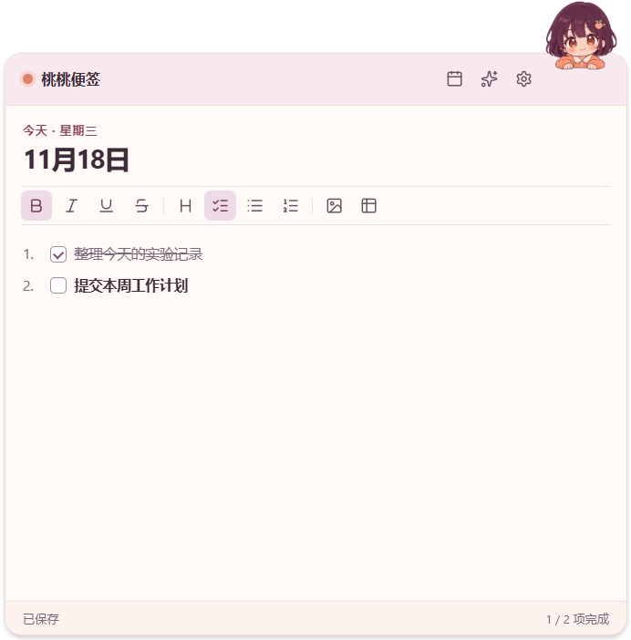

# 🍑 桃桃便签 · Momo Notes

带桌宠的 Windows 日历便签。桃桃平时在桌面，单击后趴到便签右上角，再点她就收起便签。



## 安装

在 [GitHub Releases](https://github.com/SDUM-Liu/momo-notes/releases) 下载 Windows x64 安装程序。初始版本的安装包没有代码签名。

## 使用

- 启动后显示桌宠。点桌宠或任务栏托盘中的桃桃图标打开便签。便签面板约占当前显示器工作区的八分之一，小屏幕会优先保留编辑空间。
- 拖动桌宠或便签标题到屏幕边缘可收起为边栏入口。单击边栏打开便签，或把它拖离边缘恢复桌宠。可在设置中关闭贴边收起和窗口置顶、启用开机启动、替换边栏图片。
- 每天按 Windows 本地日期创建新页。日历按钮可查看今天和有记录的旧页。应用连续运行时会自动切换到新的一天，也可随时从历史页返回今天。
- 新页默认是编号待办。输入事项后按 Enter 新增下一条，空白待办按 Enter 退出列表。可勾选白色方块标记完成，再次点击恢复。
- 工具栏支持粗体、斜体、下划线、删除线、标题、列表、图片和表格。图片也可粘贴或拖入。选中表格内某个单元格后可添加或删除行列。

## AI 问答

1. 打开设置，填写兼容 Chat Completions 的 API 地址和模型 ID。例如接口地址为 `https://example.com/v1/chat/completions` 时，API 地址可以填 `https://example.com/v1`。
2. 云服务通常需要 API 密钥。本机 API 可以使用 HTTP，其他地址须使用 HTTPS。使用本地 HTTP 代理时填入它的端口，留空则直连。
3. 点工具栏的星星，选择当前日期或含历史便签，再输入问题并发送。请求包含问题和选定便签的文字及完成状态。图片按占位符提供，历史文字最多发送约 24,000 字符。

便签按日保存在 Windows 应用数据目录的 `notes/` 中。右键托盘图标可打开数据目录。密钥由 Windows 凭据保护机制加密。AI 请求只在主动发送问题时发出。

## 从源码运行

使用 Windows 10/11 x64 和 Node.js 22.12+（建议 Node.js 24）。

```powershell
npm ci
npm start
```

运行 `npm run dist` 生成 x64 安装程序，输出在 `release/`。源码采用 MIT 许可证。

## 角色素材

用内置 ImageGen 为原创角色生成三个透明贴图，保存在 `src/assets/`。三种构图为全身挥手、双手扒住便签上缘、双手抱住侧边栏把手。共同设定为短深梅色头发、桃子发夹、杏色开衫和柔和的桃粉配色。
